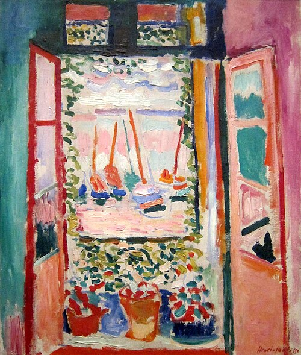

<!DOCTYPE html>
<html lang="en">
<head>
    <meta charset="UTF-8">
    <meta name="viewport" content="width=device-width, initial-scale=1.0">

    <title>Ashley Chun | Counselor Education</title>

    
</head>

<body>

    <!-- Header and navigation -->

    <header>

        

            <h1>
                <a href="index.html">ASHLEY CHUN</a>
            </h1>

            
COUNSELOR EDUCATION

        

        <nav class="main-nav">

            <a href="cv.html">CV</a>

            <a href="research.html">
                Research and Scholarship
            </a>

            <a href="teaching.html">Teaching</a>

            <a href="counseling.html">Counseling</a>

            <a href="supervision.html">Supervision</a>

            <a href="leadership.html">
                Leadership and Advocacy
            </a>

        </nav>

    </header>

    <!-- Main homepage -->

    <main>

        <section class="hero">

            <figure class="artwork">

                

                <figcaption class="art-credit">
                    Henri Matisse,
                    <i>Open Window, Collioure</i> (1905).
                    National Gallery of Art.
                </figcaption>

            </figure>

            

                
                    WELCOME TO MY PORTFOLIO
                

                <h2>
                    Counselor. 
                    Educator. 
                    Researcher.
                </h2>

                

                    I am a doctoral student in Counselor
                    Education at the University of Florida.
                

                

                    My professional interests include
                    school counseling, counselor education,
                    and student development.
                

            

        </section>

    </main>

    <!-- Footer -->

    <footer>

        
ASHLEY CHUN

        

            Counselor Education | University of Florida
        

        
&copy; 2026 Ashley Chun

    </footer>

</body>
</html>
